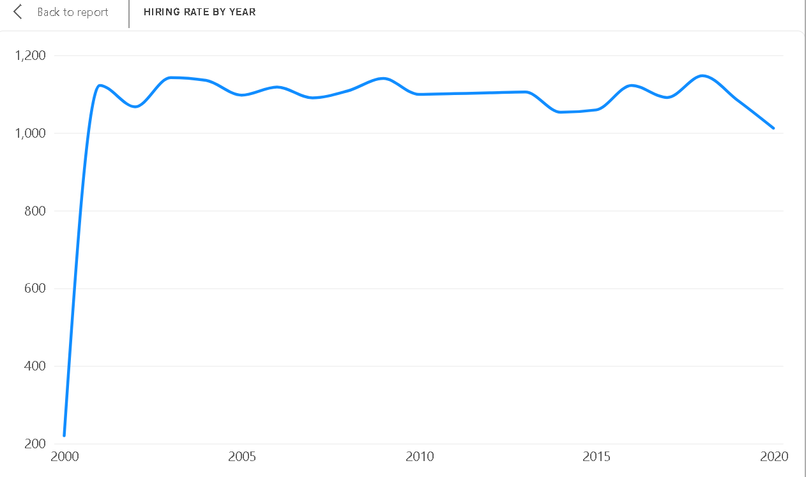
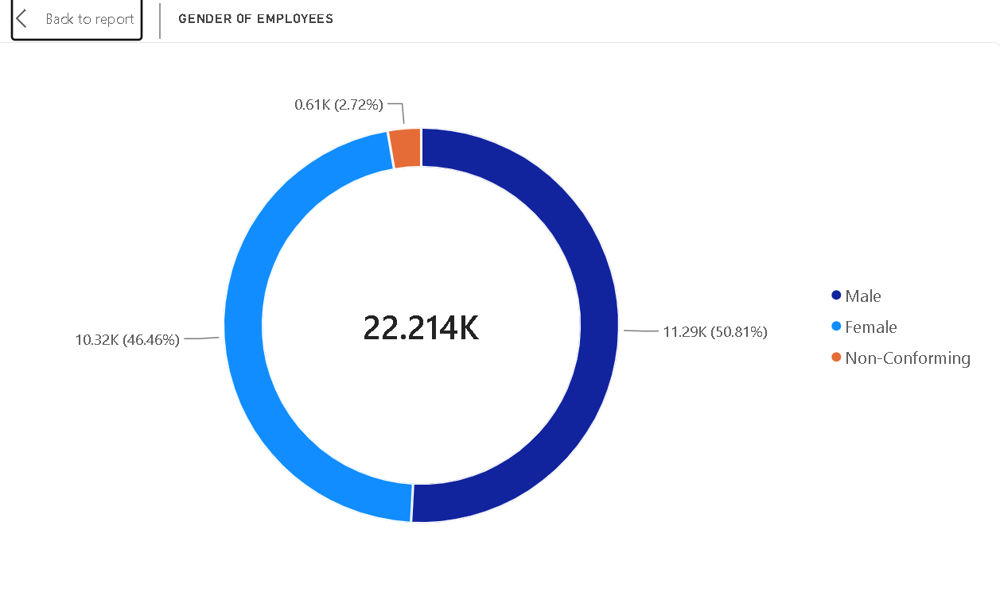
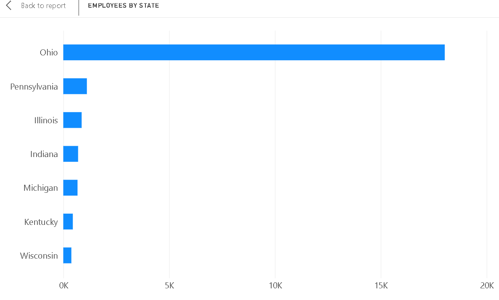
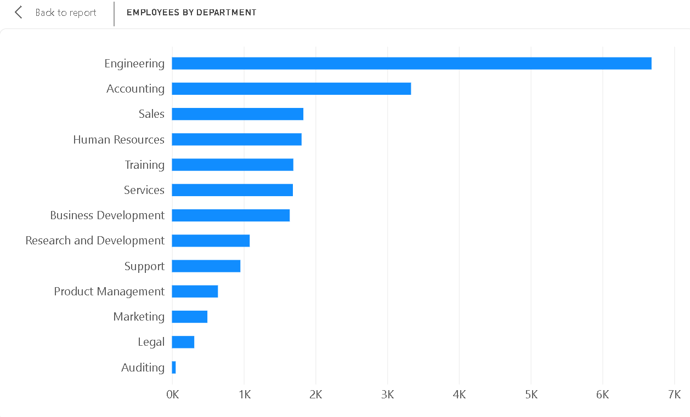
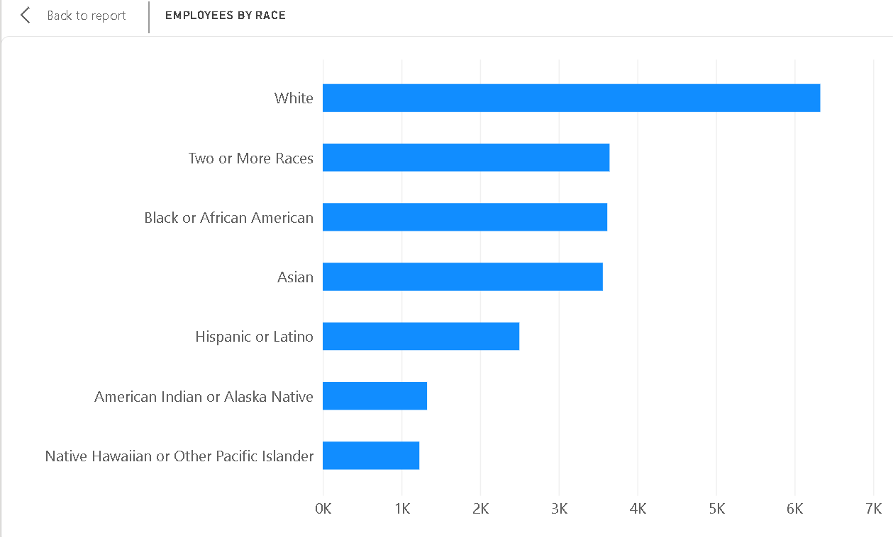

# HR Analytics Dashboard (PRDA-03)

Analysis of an HR dataset of **22,214 employees** across 13 attributes (department, job title, race, gender, location, hire/term dates, etc.). The project covers KPI reporting, workforce charts, insights and business recommendations.

## Key KPIs
| Total employees | Remote workers | HQ workers | Average age |
|:-:|:-:|:-:|:-:|
| 22,214 | 24.75% | 75.25% | 38.43 |

## Visualizations
| | |
|---|---|
|  |  |
|  |  |
|  | |

## Key Insights
- **Engineering** is the largest department (6,686 employees).
- **Ohio** dominates the workforce (18,025 employees); the company is heavily HQ-based (75.25%).
- Gender split: Male 50.81%, Female 46.46%, Non-Conforming 2.72%.
- **White** is the largest race category (6,328 employees).
- Hiring is broadly stable at ~1,000–1,150 per year; peak in **2018** (1,147).

## Recommendations
- Review engineering capacity regularly, as it is the largest department.
- Evaluate geographic concentration in Ohio and broaden talent distribution where appropriate.
- Use role-level productivity and retention measures before expanding remote work.
- Monitor diversity by department and job level, not just overall.
- Use historical hiring patterns as a baseline for recruitment planning.

## Repository Structure
```
├── data/      hr_analytics_anonymized.csv  (names and birthdates removed)
├── images/    dashboard chart screenshots
├── docs/      report, presentation (.docx/.pptx + PDF), original task brief
└── README.md
```

## Data Note
The original dataset contained employee names and birthdates. These columns were removed (`first_name`, `last_name`, `birthdate`); `Age` is retained.

## Tools
Tableau / Power BI for dashboards; report and presentation in Word and PowerPoint.
